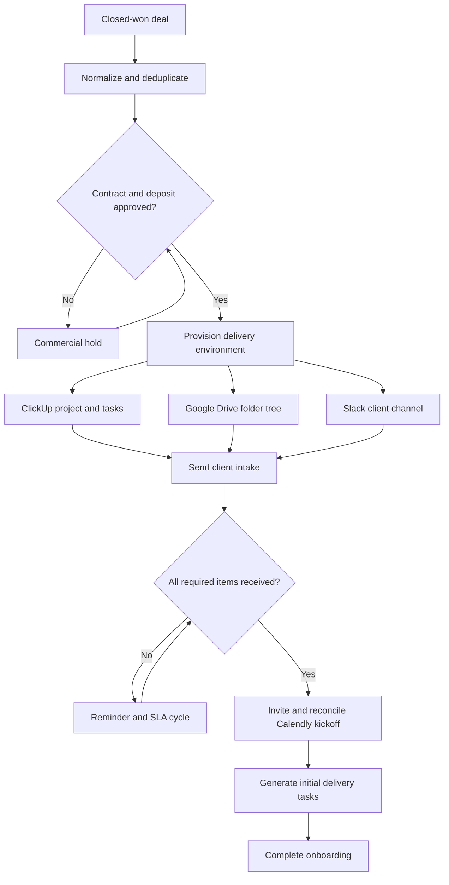

# Case Study — Client Onboarding OS

## From closed-won to kickoff without manual admin

Client onboarding in a service business is rarely one task. It is a cross-functional handoff across sales, finance, legal, operations, delivery, and the client. The work often lives in inboxes and checklists: confirm the agreement, verify payment, create folders and projects, request information, chase missing items, schedule kickoff, and tell the team what changed.

Client Onboarding OS turns that fragmented process into one observable lifecycle.

## The challenge

After a deal closes, teams commonly face four operational problems:

1. **The handoff is incomplete.** Delivery receives a client name but not the owner, scope, commercial status, or source records it needs.
2. **Provisioning is repetitive.** The same project, folder tree, channel, permissions, templates, and starter tasks are rebuilt manually.
3. **Client dependencies are invisible.** Missing questionnaires, files, and scheduling decisions sit in email threads without a reliable escalation path.
4. **Managers see activity, not readiness.** A CRM can say the deal is won while the delivery team still cannot start.

The result is avoidable delay between revenue being won and work being ready to begin.

## The objective

Design a reusable onboarding operating system for agencies, consultancies, accounting firms, recruiting companies, and other professional-services teams that can:

- start automatically from a closed-won CRM event;
- prevent premature delivery setup until commercial requirements pass;
- provision a consistent delivery environment;
- make client dependencies explicit and follow them up automatically;
- produce a kickoff-ready record with evidence, ownership, and SLA status;
- recover safely when one external integration fails.

## The solution

The system separates orchestration, business state, provider resources, and user experience:

- **HubSpot** supplies the closed-won sales event and associated context.
- **Stripe and DocuSign** form a two-part commercial readiness gate.
- **n8n** coordinates provider calls and lifecycle transitions.
- **PostgreSQL** remains the canonical system of record.
- **ClickUp, Google Drive, and Slack** form the delivery environment.
- **Gmail** delivers intake requests and reminders.
- **Calendly** captures kickoff scheduling and meeting details.
- **Next.js** exposes the manager dashboard and tokenized client intake portal.

## How the workflow operates

### 1. Sales-to-operations handoff

An authenticated n8n poller checks HubSpot for newly closed-won deals. It enriches the deal with its associated contact, company, and owner, converts provider-specific fields into a canonical payload, and calls a transactional PostgreSQL function.

The source deal ID is the idempotency anchor: replaying or polling the same deal updates the existing lifecycle instead of creating a duplicate client onboarding.

### 2. Commercial readiness

The onboarding receives two blocking requirements: contract approval and deposit approval. Stripe events correlate using onboarding or source-deal metadata. DocuSign creates the agreement from a template and later reconciles envelope status.

Provisioning cannot start until every blocking requirement is approved. Out-of-order events are safe because each provider updates its own requirement and the database reevaluates the shared gate.

### 3. Delivery provisioning

When the gate opens, n8n creates three real external resources:

- a ClickUp client delivery area and template-driven starter tasks;
- a Google Drive client root with a standard folder tree;
- a Slack client channel containing the handoff summary and links.

Each operation uses a deterministic resource key and persists the returned provider ID and URL. A successful step is never repeated simply because another provider failed.

### 4. Client intake and reminders

The application issues an opaque intake token and Gmail sends the client a direct link. Requirements are stored individually, allowing the dashboard to show exactly what is missing instead of a generic “waiting on client” label.

The reminder workflow checks only incomplete requirements that are due, records delivery activity, and stops automatically when the client finishes intake.

### 5. Kickoff and delivery start

Once intake is complete, the client receives a tracked Calendly scheduling link. The booking poller records the event, timezone, attendees, and meeting location. The workflow generates the initial delivery tasks, updates internal stakeholders, and advances the record to completion.

## Manager experience

The dashboard is designed as an operations ledger rather than another CRM pipeline. It answers five practical questions for every onboarding:

1. Where is the client in the lifecycle?
2. What is blocking the next transition?
3. Who owns the next action?
4. Which external resources were created?
5. Is the onboarding healthy, at risk, or breached?

The attention queue prioritizes commercial holds, missing client items, overdue kickoff work, and provider failures. The client detail view exposes requirements, provider resources, audit events, failure attempts, kickoff details, and the next available action.

## Reliability decisions

### PostgreSQL, not workflow memory

n8n execution history is useful for debugging, but it is not durable business state. PostgreSQL stores every lifecycle transition and external resource, allowing the dashboard and recovery workflows to reason about the same truth.

### Idempotency at every mutation

Inbound deals and provider operations use stable identifiers. Replays, retries, and polling overlap do not create duplicate onboardings, channels, folders, or tasks.

### Partial-failure recovery

Provisioning is a set of independently persisted steps. If Drive creation fails after ClickUp succeeds, the onboarding becomes partially provisioned and the retry workflow targets Drive only.

### Explicit gates and audit history

Every status change has a reason. Commercial requirements, intake items, reminders, failures, SLA events, kickoff bookings, and generated tasks remain queryable for operational review.

### Secrets remain outside source control

Workflow exports contain credential references, never provider tokens. OAuth credentials, API keys, webhook secrets, and the n8n encryption key belong in n8n credentials or deployment secrets.

## Demonstration evidence

The final controlled run proved the complete integration path:

- HubSpot produced the closed-won client record.
- Stripe and DocuSign cleared the commercial gate.
- ClickUp created a real delivery area and three starter tasks.
- Google Drive created a real client root and four standard subfolders.
- Slack created a real client channel and posted the handoff.
- Gmail delivered the intake workflow.
- Calendly recorded a real kickoff booking with a Google Meet location.
- The lifecycle reached **Complete** at **100%** with provider resources and audit state preserved.

These are sandbox/demo outcomes, not production performance metrics. The project demonstrates technical feasibility, cross-system orchestration, and operational design without claiming measured customer savings.

## What this project demonstrates

- Cross-functional automation spanning CRM, finance, agreements, delivery, communications, and scheduling.
- n8n workflow architecture beyond a single linear automation.
- Database-backed state machines, idempotency, retries, and auditability.
- A product interface that explains business outcomes instead of exposing raw workflow executions.
- Secure integration practices and a clear boundary between a portfolio demonstration and production readiness.

## Stack

| Layer | Technology |
| --- | --- |
| Sales | HubSpot |
| Commercial | Stripe, DocuSign |
| Orchestration | n8n |
| State and audit | PostgreSQL |
| Delivery | ClickUp, Google Drive, Slack |
| Communication | Gmail |
| Scheduling | Calendly |
| Product experience | Next.js, React, TypeScript |
| Local platform | Docker Compose |

## Production path

Before using the system with real client data, the next hardening stage is:

- deploy dashboard and webhooks behind public HTTPS;
- add application authentication and manager/operator roles;
- verify every inbound webhook signature;
- add managed backups, restore testing, monitoring, and alert delivery;
- define data retention and secure credential-request policies;
- separate test and production accounts and rotate secrets;
- add automated integration and end-to-end coverage for failure and replay scenarios.

## Portfolio summary

**Client Onboarding OS: From Closed-Won to Kickoff Without Manual Admin**

This project shows how a service business can turn a fragile post-sale checklist into a governed operational system: commercial conditions are enforced, workspaces are provisioned consistently, client dependencies are followed up, kickoff is tracked, and every stage is visible from one manager dashboard.
