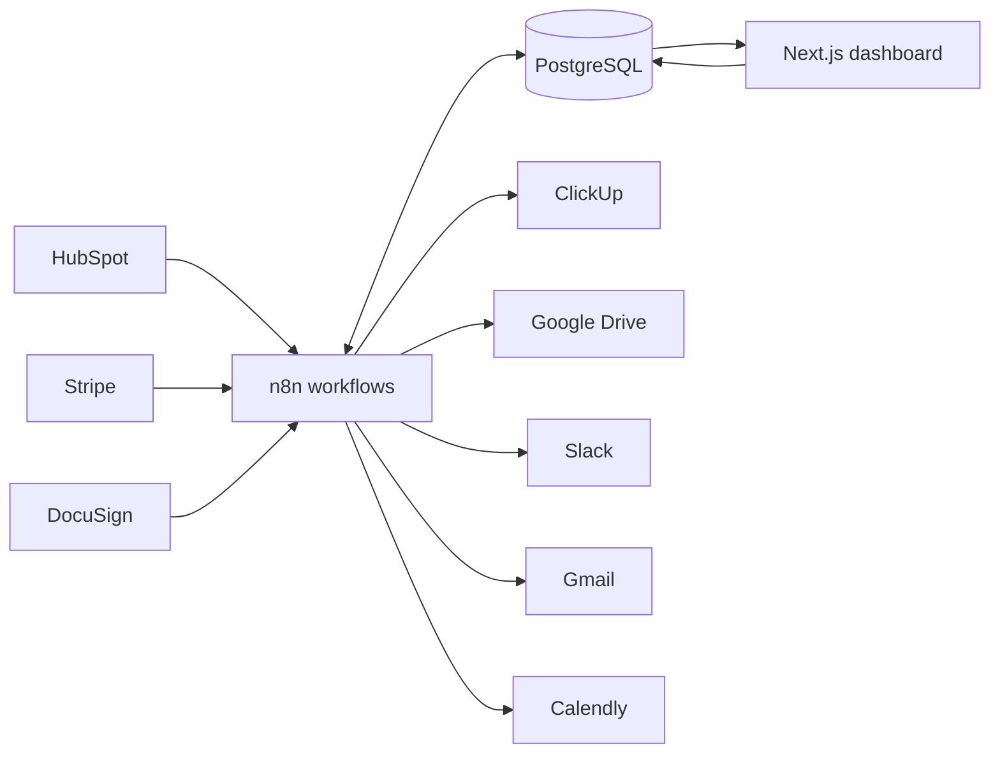

# Client Onboarding Operating System

> From closed-won to kickoff without manual admin.

Client Onboarding OS is a portfolio-grade automation system for B2B service businesses. It turns a closed-won HubSpot deal into a controlled delivery handoff: validates the contract and deposit, provisions the client workspace, gathers intake requirements, schedules kickoff, creates initial delivery tasks, and gives managers a live operational view.

The reference implementation has been exercised end to end with real sandbox/test integrations across HubSpot, Stripe, DocuSign, ClickUp, Google Drive, Gmail, Slack, and Calendly. n8n orchestrates the workflows, PostgreSQL holds canonical state, and a Next.js application provides the manager dashboard and client intake experience.

## What the system delivers

```text
HubSpot closed-won
        ↓
Contract + deposit verification
        ↓
ClickUp + Google Drive + Slack provisioning
        ↓
Client intake + missing-item reminders
        ↓
Calendly kickoff + initial delivery tasks
        ↓
SLA visibility + completed onboarding
```

For each client, the final operational output is a traceable onboarding record with:

- verified contract and deposit status;
- a ClickUp delivery area with template-driven tasks;
- a structured Google Drive client folder tree;
- a dedicated Slack handoff channel and summary;
- a secure, tokenized intake link and requirement checklist;
- a tracked Calendly kickoff booking and meeting link;
- lifecycle history, failures, retry state, owner, blocker, and SLA status.

## Integration map

| System | Role | How it is used |
| --- | --- | --- |
| HubSpot | Sales handoff | An idempotent n8n poller detects closed-won deals and enriches them with contact, company, and owner data. |
| Stripe | Deposit gate | Signed test-mode events correlate payments to the source deal and update commercial readiness. |
| DocuSign | Contract gate | OAuth-backed template envelopes are sent and polled until the agreement reaches a terminal state. |
| n8n | Orchestration | Workflows normalize events, enforce gates, provision resources, send communications, retry failures, and record transitions. |
| PostgreSQL | System of record | Stores lifecycle state, provider resources, requirements, reminders, failures, tasks, kickoff data, and audit history. |
| ClickUp | Delivery execution | Creates the client delivery area and starter tasks from a service template. |
| Google Drive | Document workspace | Creates a client root and standard onboarding subfolders. |
| Slack | Internal handoff | Creates the client channel and posts the sales-to-delivery summary with resource links. |
| Gmail | Client communication | Delivers the intake invitation and missing-item reminders. |
| Calendly | Kickoff scheduling | Supplies the tracked scheduling link and reconciles booking and meeting details. |
| Next.js | Operations interface | Provides the live ledger, attention queue, lifecycle detail, and intake portal. |
| Docker Compose | Local platform | Runs n8n and PostgreSQL predictably for development and demonstration. |

## Production-grade behavior demonstrated

- Idempotent closed-won ingestion prevents duplicate onboardings.
- Commercial provisioning stays blocked until every required gate passes.
- Provider IDs and URLs are persisted instead of living only in n8n execution history.
- Provisioning steps are independently recoverable, so a failed provider can be retried without duplicating successful resources.
- Intake links use opaque tokens; reminders stop when requirements are completed.
- SLA monitoring exposes records that are waiting, at risk, or breached.
- A global error workflow normalizes failures for operational notification.
- Workflow exports and fixtures are sanitized; credentials remain in n8n or deployment secrets.

## Verified demonstration

The reference run completed the full sandbox/test lifecycle:

1. A HubSpot deal moved to **Closed Won**.
2. Stripe confirmed the deposit and DocuSign confirmed the agreement.
3. n8n created real ClickUp, Drive, and Slack resources.
4. Gmail delivered the intake request and the client requirements were completed.
5. Calendly recorded a real kickoff booking with meeting details.
6. Initial tasks were generated and the onboarding reached **Complete — 100%**.

This proves the integration path in controlled accounts. It is not a claim of production traffic, customer adoption, or measured business savings.

## Architecture



PostgreSQL is deliberately the business system of record. n8n execution history supports diagnostics, but lifecycle decisions and external resource identifiers remain queryable and recoverable independently.

## Repository guide

```text
apps/dashboard/          Next.js manager dashboard and client intake portal
automation/workflows/    Sanitized, importable n8n workflow exports
automation/fixtures/     Safe webhook fixtures for local testing
database/migrations/     PostgreSQL schema and lifecycle functions
docs/architecture/       Architecture notes
docs/integrations/       Credential and go-live guidance
CASE_STUDY.md            Portfolio case study
```

## Run locally

Requirements: Docker with Compose, Node.js 20+, npm, and provider test accounts for live integration tests.

```bash
cp .env.example .env
docker compose up -d
npm install
npm run dev
```

- Dashboard: `http://localhost:3000`
- n8n: `http://localhost:5678`
- PostgreSQL host port: `55432`

On the first n8n launch, create the local owner account, add credentials inside n8n, and import the required files from `automation/workflows/`. Never commit provider tokens, OAuth secrets, webhook secrets, or an n8n encryption key.

Database migrations run automatically only when the PostgreSQL volume is first created. Apply later migrations with a migration runner or `psql`; do not recreate a volume that contains data.

## Validate the application

```bash
npm run typecheck
npm run lint
npm run build
docker compose config --quiet
```

## Operational workflows

- `01–04`: HubSpot intake and commercial verification;
- `05`: real ClickUp, Google Drive, and Slack provisioning;
- `10–11`: Gmail intake invitations and reminder cycles;
- `12–13`: Calendly kickoff and onboarding completion;
- `14–15`: SLA monitoring and targeted provisioning recovery;
- `99`: global failure normalization and notification handoff;
- `00-*`: provider connection checks.

See [automation/README.md](automation/README.md) for workflow contracts and [docs/integrations/CREDENTIAL_SETUP.md](docs/integrations/CREDENTIAL_SETUP.md) for safe credential setup.

## Scope and deployment boundary

The portfolio build uses provider sandbox, demo, or test environments and runs locally. Before handling real client data, deploy behind HTTPS and add application authentication, role-based access, secret rotation, backups, webhook verification for every inbound provider, monitoring, data-retention controls, and a documented recovery procedure.

## Case study

Read [CASE_STUDY.md](CASE_STUDY.md) for the business problem, design decisions, end-to-end workflow, implementation evidence, reliability model, and portfolio narrative.

For a repeatable client walkthrough, use [SHOWCASE_GUIDE.md](SHOWCASE_GUIDE.md).
